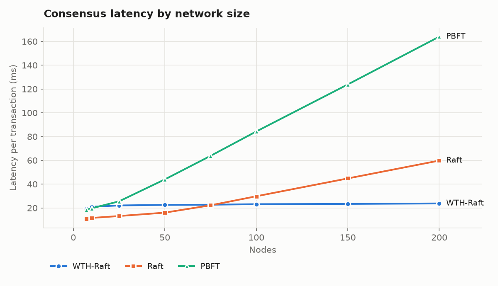
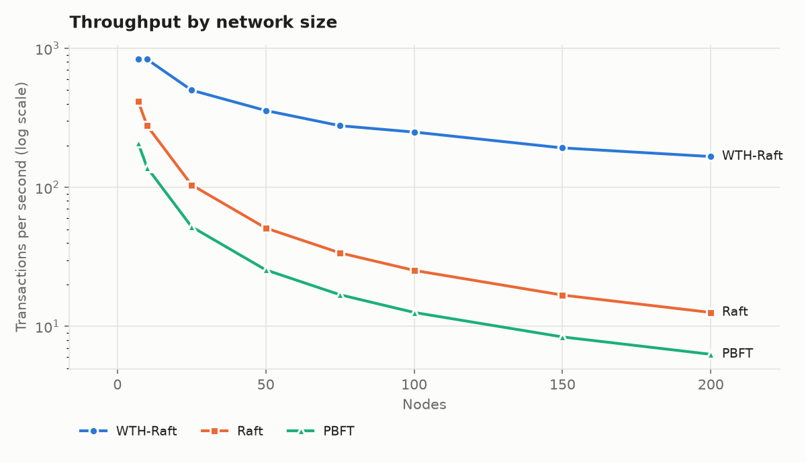
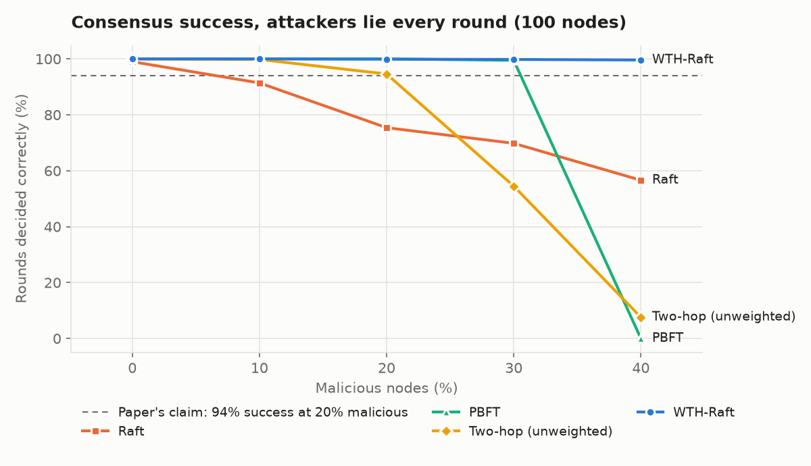
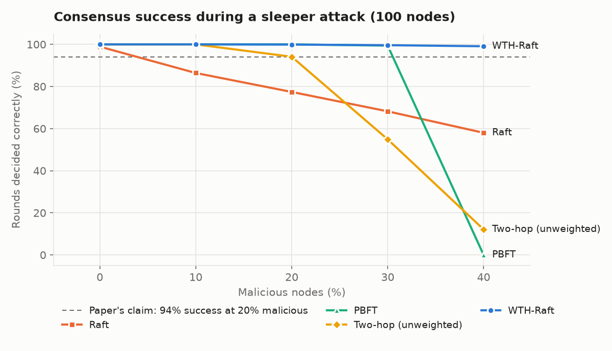

# WTH-Raft simulation results

Generated by `python simulation/run.py`. Do not edit by hand: re-run the script.
See [README.md](README.md) for the model and its assumptions.

## The paper's claims, checked

| Claim in the paper | This simulation | Verdict |
| --- | --- | --- |
| Two-hop cuts consensus latency by about 25-30% vs flat architectures at scale | Lower latency than Raft for large networks: 22% at 100 nodes, 47% at 150 nodes, 60% at 200 nodes; but it is *slower* than Raft below 100 nodes (+78% at 7 nodes), because of the extra hop | Partly confirmed: the reduction depends on network size |
| Throughput stays stable past 50 nodes while Raft and PBFT degrade sharply | From 50 to 200 nodes, TPS changes by -53% for WTH-Raft, -75% for Raft, -75% for PBFT; at 200 nodes WTH-Raft handles 13.2x Raft's TPS | Partly confirmed: WTH-Raft is much faster at every size, but its TPS still falls as the network grows, because the work of the leader and each primary grows with the square root of the network size |
| Consensus success above 94% with 20% malicious nodes | 99.9% for WTH-Raft (100 nodes), vs 75.4% Raft, 100.0% PBFT, 94.6% unweighted two-hop | Confirmed, under the assumptions below |
| (Not in the paper) the same, against sleeper attackers that build reputation first | 99.9% of attack rounds for WTH-Raft (99.0% in the first 10), vs 77.4% Raft, 100.0% PBFT | WTH-Raft still holds, because honest nodes keep most of the weight |

Two-hop does not reduce the *total* number of messages (398 per transaction at 200 nodes for both Raft and WTH-Raft). It spreads them over the primaries, so no single node, especially the leader, has to send and process them all.

## Latency and throughput

| Nodes | Raft latency (ms) | PBFT latency (ms) | WTH-Raft latency (ms) | Raft TPS | PBFT TPS | WTH-Raft TPS |
| --- | --- | --- | --- | --- | --- | --- |
| 7 | 10.8 | 18.4 | 19.3 | 416.7 | 208.3 | 833.3 |
| 10 | 11.6 | 19.7 | 21.0 | 277.8 | 138.9 | 833.3 |
| 25 | 13.2 | 25.5 | 22.1 | 104.2 | 52.1 | 500.0 |
| 50 | 16.0 | 44.0 | 22.5 | 51.0 | 25.5 | 357.1 |
| 75 | 22.2 | 63.8 | 22.7 | 33.8 | 16.9 | 277.8 |
| 100 | 29.8 | 84.3 | 23.1 | 25.3 | 12.6 | 250.0 |
| 150 | 44.8 | 123.8 | 23.4 | 16.8 | 8.4 | 192.3 |
| 200 | 59.8 | 164.0 | 23.8 | 12.6 | 6.3 | 166.7 |

**The key assumption** behind the Byzantine results: after every round, an off-chain inspection reveals the truth, and the contract scores every node's report against it. Real inspections are slower, sampled and themselves fallible. With a weaker oracle, malicious nodes would keep their weight for longer, and the results would move towards the unweighted two-hop line.

## Byzantine resilience: attackers lie every round (100 nodes)

| Malicious nodes | Protocol | Success, all rounds | Success, attack rounds | Success, first 10 attack rounds | Malicious share of weight at end | Honest nodes wrongly suspended (avg) | Malicious nodes suspended (avg) |
| --- | --- | --- | --- | --- | --- | --- | --- |
| 0% | Raft | 99.0% | 99.0% | 99.0% | n/a (unweighted) | n/a | n/a |
| 0% | PBFT | 100.0% | 100.0% | 100.0% | n/a (unweighted) | n/a | n/a |
| 0% | Two-hop (unweighted) | 100.0% | 100.0% | 100.0% | n/a (unweighted) | n/a | n/a |
| 0% | WTH-Raft | 100.0% | 100.0% | 100.0% | 0.0% | 0.25 | 0.0 |
| 10% | Raft | 91.4% | 91.4% | 94.5% | n/a (unweighted) | n/a | n/a |
| 10% | PBFT | 100.0% | 100.0% | 100.0% | n/a (unweighted) | n/a | n/a |
| 10% | Two-hop (unweighted) | 99.8% | 99.8% | 100.0% | n/a (unweighted) | n/a | n/a |
| 10% | WTH-Raft | 100.0% | 100.0% | 100.0% | 0.0% | 0.15 | 10.0 |
| 20% | Raft | 75.4% | 75.4% | 79.5% | n/a (unweighted) | n/a | n/a |
| 20% | PBFT | 100.0% | 100.0% | 100.0% | n/a (unweighted) | n/a | n/a |
| 20% | Two-hop (unweighted) | 94.6% | 94.6% | 94.5% | n/a (unweighted) | n/a | n/a |
| 20% | WTH-Raft | 99.9% | 99.9% | 98.5% | 0.0% | 0.15 | 20.0 |
| 30% | Raft | 69.8% | 69.8% | 69.5% | n/a (unweighted) | n/a | n/a |
| 30% | PBFT | 99.5% | 99.5% | 100.0% | n/a (unweighted) | n/a | n/a |
| 30% | Two-hop (unweighted) | 54.5% | 54.5% | 47.5% | n/a (unweighted) | n/a | n/a |
| 30% | WTH-Raft | 99.8% | 99.8% | 95.0% | 0.0% | 0.0 | 30.0 |
| 40% | Raft | 56.6% | 56.6% | 50.0% | n/a (unweighted) | n/a | n/a |
| 40% | PBFT | 0.0% | 0.0% | 0.0% | n/a (unweighted) | n/a | n/a |
| 40% | Two-hop (unweighted) | 7.6% | 7.6% | 8.5% | n/a (unweighted) | n/a | n/a |
| 40% | WTH-Raft | 99.6% | 99.6% | 92.0% | 0.0% | 0.1 | 40.0 |

## Byzantine resilience: sleeper attackers: honest for the first half, then all lie (100 nodes)

| Malicious nodes | Protocol | Success, all rounds | Success, attack rounds | Success, first 10 attack rounds | Malicious share of weight at end | Honest nodes wrongly suspended (avg) | Malicious nodes suspended (avg) |
| --- | --- | --- | --- | --- | --- | --- | --- |
| 0% | Raft | 98.9% | 98.9% | 99.5% | n/a (unweighted) | n/a | n/a |
| 0% | PBFT | 100.0% | 100.0% | 100.0% | n/a (unweighted) | n/a | n/a |
| 0% | Two-hop (unweighted) | 100.0% | 100.0% | 100.0% | n/a (unweighted) | n/a | n/a |
| 0% | WTH-Raft | 100.0% | 100.0% | 100.0% | 0.0% | 0.25 | 0.0 |
| 10% | Raft | 92.8% | 86.4% | 88.0% | n/a (unweighted) | n/a | n/a |
| 10% | PBFT | 100.0% | 100.0% | 100.0% | n/a (unweighted) | n/a | n/a |
| 10% | Two-hop (unweighted) | 99.8% | 100.0% | 100.0% | n/a (unweighted) | n/a | n/a |
| 10% | WTH-Raft | 100.0% | 100.0% | 100.0% | 0.0% | 0.05 | 10.0 |
| 20% | Raft | 88.4% | 77.4% | 78.0% | n/a (unweighted) | n/a | n/a |
| 20% | PBFT | 100.0% | 100.0% | 100.0% | n/a (unweighted) | n/a | n/a |
| 20% | Two-hop (unweighted) | 95.6% | 94.1% | 100.0% | n/a (unweighted) | n/a | n/a |
| 20% | WTH-Raft | 98.0% | 99.9% | 99.0% | 0.0% | 0.15 | 20.0 |
| 30% | Raft | 83.9% | 68.2% | 69.0% | n/a (unweighted) | n/a | n/a |
| 30% | PBFT | 99.7% | 99.4% | 99.5% | n/a (unweighted) | n/a | n/a |
| 30% | Two-hop (unweighted) | 74.0% | 54.9% | 63.0% | n/a (unweighted) | n/a | n/a |
| 30% | WTH-Raft | 92.5% | 99.6% | 95.5% | 0.0% | 0.0 | 30.0 |
| 40% | Raft | 78.4% | 58.0% | 74.0% | n/a (unweighted) | n/a | n/a |
| 40% | PBFT | 50.0% | 0.0% | 0.0% | n/a (unweighted) | n/a | n/a |
| 40% | Two-hop (unweighted) | 40.3% | 12.1% | 20.0% | n/a (unweighted) | n/a | n/a |
| 40% | WTH-Raft | 89.5% | 99.1% | 91.5% | 0.0% | 0.1 | 40.0 |

*Two-hop (unweighted)* is an ablation, not a protocol from the paper: it is WTH-Raft's structure with one node, one vote. It shows how much of WTH-Raft's resilience comes from the weighting.

Reputation parameters (the same as the contract's defaults): alpha = 50, beta = 50, initialQuality = 50, initialReputation = 50, honestReward = 2, penalty = 20, tolerance = 10, minQuality = 40, suspendBelow = 20.
Run settings: 30 samples per point (PBFT at 100+ nodes: 10), 200 rounds x 20 trials per Byzantine point.
